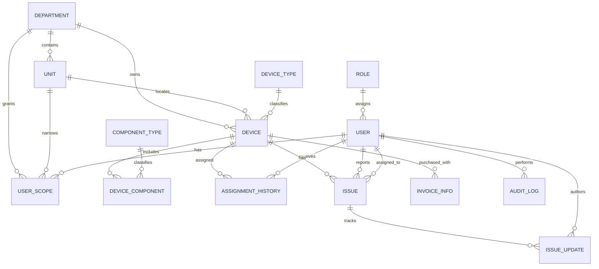

# Ekran ve Veritabanı Taslağı

**Proje:** IT Donanım Envanter ve Destek Sistemi  
**Sürüm:** 0.1 — Gereksinim görüşmesine dayalı taslak

## 1. Ekran haritası

### Her rol
- Giriş: kullanıcı adı ve parola
- Ana sayfa: rol ve yetki kapsamına uygun özetler
- Profil / parola değiştirme

### Ana Admin
- Genel bakış: toplam cihaz, aktif arıza, garanti bitişleri, departman özeti
- Departmanlar ve birimler: ekle, düzenle, pasife al
- Kullanıcılar: oluştur, rol ata, IT sorumlusu kapsamı belirle, hesabı pasife al
- Tüm cihazlar ve bileşenler: listele, ara, ekle, düzenle, geçmişe bak
- Arıza kayıtları: tüm kapsamda gör, ata, durum/öncelik değiştir, çözüm gir
- Raporlar: departman, cihaz türü/durumu, atama, arıza ve garanti filtreleri
- Sistem tanımları: cihaz türü, bileşen türü, durum ve özel alan tanımları

### IT Sorumlusu
- Ana sayfa: kendi yetki alanındaki cihazlar ve arızalar
- Cihaz ve bileşen listesi: kendi departman/birim kapsamı içinde
- Cihaz kaydı / düzenleme ve kişiye atama
- Arıza kuyruğu ve arıza detay/işlem geçmişi
- Yetki kapsamındaki raporlar

### Birim Kullanıcısı
- Bana atanan cihazlar
- Arıza bildirimi: cihaz seç, konu/açıklama yaz, varsa öncelik belirt
- Bildirdiklerim: durum ve IT güncellemelerini gör

## 2. Önemli kullanıcı akışları

**Yeni cihaz:** IT/Admin → cihaz türü seç → temel bilgileri gir → departman/birim ve kişiyi ata → bileşenleri ekle → kaydet. Sistem cihaz numarası üretir; QR daha sonraki sürümde bu cihaza bağlanabilir.

**Parça değişimi:** cihaz detayını aç → bileşeni değiştir → mevcut bileşen için çıkarılma tarihi/işlemi kaydet → yeni bileşeni ekle. Eski bileşen ve işlem geçmişte kalır.

**Arıza bildirimi:** kullanıcı kendi cihazını seçer → açıklama gönderir → IT sorumlusu kaydı üstlenir → durum ve yapılan işlemler eklenir → çözüldü olarak kapatılır.

## 3. Veri modeli

## 4. Tabloların ilk taslağı

- `roles`: rol kodu ve adı (ana_admin, it_sorumlusu, birim_kullanıcısı)
- `users`: kullanıcı adı, parola özeti, ad-soyad, rol, aktiflik
- `departments`: departman adı, kod, aktiflik
- `units`: departman, birim adı, kod, aktiflik
- `user_scopes`: kullanıcı, departman ve isteğe bağlı birim kapsamı; admin için tüm kapsam
- `device_types`: bilgisayar, monitör, yazıcı vb.; genişletilebilir tür listesi
- `devices`: cihaz no, tür, marka/model, seri no, IP/MAC, durum, departman/birim, açıklama, oluşturma/değiştirme bilgileri
- `component_types`: RAM, SSD, işlemci vb.; yeni tür eklenebilir
- `device_components`: cihaz, bileşen türü, üretici/model, seri no, teknik özellikler, takılma/çıkarılma tarihi, aktiflik
- `assignment_history`: cihaz, kullanıcı, başlangıç/bitiş tarihi, atayan kullanıcı
- `invoice_info`: opsiyonel fatura no, satıcı, tarih, tutar, para birimi; dosya alanı yok
- `issues`: cihaz, bildiren, atanan IT sorumlusu, başlık/açıklama, öncelik, durum, açılış/kapanış zamanı
- `issue_updates`: arıza kaydı, güncelleme metni, durum değişimi, ekleyen kişi ve tarih
- `audit_logs`: kullanıcı, işlem, etkilenen kayıt, zaman; hassas değişikliklerin izlenmesi

## 5. Esneklik ve veri kuralları

- Sabit cihaz/bileşen türlerini kod içine gömmek yerine `device_types` ve `component_types` kayıtlarıyla yönet.
- Değişken teknik alanlar için ilk sürümde JSON alanı veya tür bazlı özellik tanımları değerlendirilebilir. Aranacak kritik alanlar (seri no, IP, MAC, demirbaş no) normal sütunlarda ve indeksli olmalı.
- Bir cihazın yalnızca bir aktif kullanıcı ataması olmalı; yeni atama eskisinin bitiş tarihini kapatmalı.
- Cihaz ve bileşen silinmesi yerine pasife alma/çıkarılma kullanılmalı.
- Yetki filtresi sunucu tarafında uygulanmalı; yalnızca arayüzde gizlemek yeterli değildir.
- Parolalar düz metin tutulmamalı; güvenli parola özeti kullanılmalı.

## 6. İlk sürümde kapsam dışı / sonraki aşama

QR kod, fatura dosyası yükleme, ağdan otomatik cihaz keşfi, ortak oda/lokasyon ataması ve gelişmiş dışa aktarma. Fatura dosyası yükleme ile otomatik IP keşfi kullanıcı kararıyla kapsam dışında bırakılmıştır.

## 7. Tasarım öncesi doğrulanacak maddeler

1. IT sorumlusu departman mı yoksa birim seviyesinde mi yetkilendirilecek?
2. Hangi cihaz ve bileşen alanları zorunlu olacak?
3. Fiyat/tutar raporlarını kimler görebilecek?
4. Veri saklama ve yedekleme için şirketin belirlediği kural nedir?
5. Teknoloji/hosting için şirket standardı var mı?
